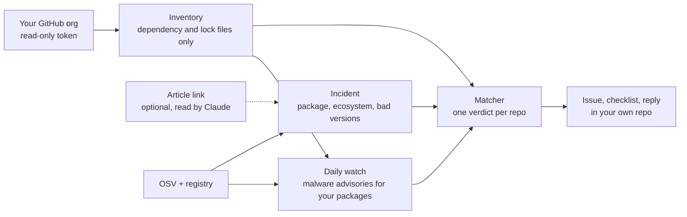

<div align="center">

<picture>
  <source media="(prefers-color-scheme: dark)" srcset="docs/images/logo-dark.svg">
  
</picture>

**Know in a minute which of your repos use a compromised package.**

When a dependency you rely on is hijacked or found vulnerable, blastcheck checks every repo in your GitHub org and drafts the reply. It runs in your own setup, on your own credentials. Nothing is hosted and your code is never sent anywhere.

[](https://github.com/phronetic-ai/blastcheck/actions/workflows/test.yml)
[](CHANGELOG.md)
[](LICENSE)
[](https://www.python.org)
[](pyproject.toml)
[](#privacy)
[](skill/incident-check/SKILL.md)

[Why](#why-blastcheck) · [Features](#features) · [See it in action](#see-it-in-action) · [Where the intelligence is](#where-the-intelligence-is) · [Install](#install) · [Quick start](#quick-start) · [How it works](#how-it-works) · [Privacy](#privacy) · [FAQ](#faq)

</div>

```
$ blastcheck check --org acme-labs --package agent-framework --ecosystem pypi --bad 1.26.1,1.26.2

AT RISK — a loose version range could have pulled a bad version
confirmed: OSV lists MAL-2026-20101 for agent-framework 1.26.1

We checked all 142 repos. None pin an affected version of agent-framework (1.26.1 and 1.26.2),
but 2 use it with a loose version range that could have pulled one: billing-api, ops-notebooks.
We are checking when those were last installed and pinning them to a safe version.
```

<p align="center"><sub><code>acme-labs</code> and its repos are invented. The advisory is real.</sub></p>

## Why blastcheck?

A widely used package gets a malicious release. Within the hour an article is in your inbox with one line above it: *can we check if we are using this?*

Answering that properly means every repo, every lock file, and the loose version ranges that would have pulled the bad release without anyone choosing it. Most teams write a throwaway script, miss a few file layouts, and reply "I think we're fine".

Alert tools don't answer this question. They report thousands of known vulnerabilities per org and get tuned out; they rarely cover malicious releases across ecosystems; and none of them hand you a sentence you can forward.

blastcheck does one thing: **given a bad release, say exactly which of your repos are exposed, how, and what to do**, and say plainly when it could not read something.

- **For whoever gets the forwarded article:** a verdict per repo and a reply you can send, in a minute.
- **For security and platform teams:** a daily sweep that stays silent unless a malicious release matches something you actually use.
- **For engineers:** the exact file, line and branch to fix.

## Features

<table>
<tr>
<td width="50%" valign="top">

**🎯 One verdict per repo**<br>
Affected, at risk, safe version, not used, or could not check. Each comes with the file and the line that justifies it.

</td>
<td width="50%" valign="top">

**🪤 Catches loose pins**<br>
`agent-framework>=1.20` pins nothing. If a range would have accepted the bad release and no lock file of the same tool protects it, the repo is flagged as at risk.

</td>
</tr>
<tr>
<td valign="top">

**✅ Confirmed against the source**<br>
The incident is checked against the public OSV database and the package registry. A report built from an article alone is labelled unconfirmed until one of them agrees.

</td>
<td valign="top">

**🚫 Never a false "all clear"**<br>
One unreadable repo, an unsupported lock format or a failed lookup turns the answer into *incomplete*, and the drafted reply says so.

</td>
</tr>
<tr>
<td valign="top">

**🌿 Active branches, cheaply**<br>
Deploy-named and recently pushed branches are read by difference: a dependency file identical to the default branch's is never downloaded. About 15% more API calls, not 5×.

</td>
<td valign="top">

**🛰️ Daily watch**<br>
Each day it asks OSV about every package your repos use. It opens an issue only when a known-malicious release matches; otherwise there is no issue, no email, and a green run.

</td>
</tr>
<tr>
<td valign="top">

**✉️ A reply you can forward**<br>
Every report ends with a short plain-language answer and a checklist: what to pin, which credentials to rotate, what the scan could not see.

</td>
<td valign="top">

**🔒 Read-only, yours, nothing hosted**<br>
One read-only token. Only dependency and lock files are downloaded; source code is never read and nothing from a repo is executed. No server of ours is involved.

</td>
</tr>
<tr>
<td valign="top">

**🧩 Three ways to run it**<br>
A command-line tool, a GitHub Action you call from a private repo of your own, and a Claude Code skill. One core, the same answer from each.

</td>
<td valign="top">

**📦 The file layouts real repos use**<br>
`requirements/prod.txt`, hash-pinned files, Poetry, uv, PDM, Pipfile, Conda, `setup.py`, npm overrides and aliases, pnpm, yarn, Go, Cargo, Maven. Broken lock files are salvaged where every entry can be recovered.

</td>
</tr>
</table>

## See it in action

The GitHub Action writes each incident as an issue in your own scan repo. This is the shape of one, with invented repos:

> ## AFFECTED — a known-bad version is pinned
>
> **Incident:** next 15.2.4 (npm)<br>
> **Package:** `next` (npm) — bad versions: `15.2.4`<br>
> **Confirmed** by an outside source: OSV lists GHSA-2464-fhr4-w9xw, GHSA-267c-6grr-h53f, GHSA-26hh-7cqf-hhc6 and 33 more for next 15.2.4
>
> Checked **142** repos in `acme-labs` on 2026-11-19 09:20 UTC. Besides each default branch, **38** other branches were checked (deploy-named or recently pushed); 21 of them differ in their dependency files.
>
> | Verdict | Repos |
> |---|---:|
> | Affected | 2 |
> | At risk | 0 |
> | Uses the package at a safe version | 12 |
> | Does not use the package | 125 |
> | Could not fully check | 3 |
>
> ### Affected
>
> | Repo | Branch | File | Declared as |
> |---|---|---|---|
> | `storefront` | default | `package-lock.json` | `next@15.2.4` |
> | `storefront` | `hotfix-markdown` | `pnpm-lock.yaml` | `next@15.2.4` |
> | `partner-portal` | default | `package.json` | `next@15.2.4` |
>
> ### What to do
>
> - [ ] Check the repos listed under "Could not fully check" by hand, or fix access and re-run
> - [ ] Pin `next` to a known-clean version in the listed files and regenerate lock files
> - [ ] Block `next` 15.2.4 in any package proxy or allow-list
>
> ### Ready-to-send reply
>
> > We checked 142 repos. 2 pin an affected version of next (15.2.4): partner-portal, storefront. … 3 repos could not be fully read, so this is not yet a complete answer; we are checking those by hand.

The daily watch prints one line when nothing matches:

```
Asked OSV about 6810 packages used in 142 repos: 58 malware advisories exist for them,
0 match what the org uses, 58 concern only versions the org does not use.
```

## Where the intelligence is

Plainly: **the part that decides whether you are affected uses no AI at all.** That is a design choice, not a gap.

| Step | Who does it | Why |
|---|---|---|
| Read dependency files across the org | Plain code | It is file parsing. It must be exact and repeatable. |
| Decide the verdict for each repo | Plain code | "Is 1.26.2 pinned here?" has one right answer. A model adds cost and a chance of being wrong. |
| Confirm the incident | OSV and the registry | An outside record, not an opinion. |
| Daily watch | Plain code + OSV | Thousands of packages a day for the price of a few requests. |
| Write the report, checklist and reply | Templates | So the wording never overstates what was checked. |
| **Turn an article link into an incident** | **Claude** (optional) | Reading prose and pulling out the package, the bad versions and the signs of compromise is what a model is good at. |
| **`/incident-check` in Claude Code** | **Claude Code** (optional) | Your own session reads the article and runs the tool. No API key. |

Two rules bound what Claude is allowed to do here:

- **It reads the public article, never your code.** Nothing from your repos is sent to a model in any mode.
- **It cannot make a verdict.** An article is untrusted input: Claude fills a fixed form (package, versions, indicators), the form is validated again, and the incident stays *unconfirmed* until OSV or the registry agrees. The matching is then done by the same plain code.

So with no API key at all, everything except "paste a link" works.

**What is planned, and is where a model earns its cost:**

| Planned | What Claude would do |
|---|---|
| Reachability | For a flagged package, read only the files that import it and answer "is the vulnerable function actually called?", with the evidence written down. This is what cuts thousands of findings to the few that matter. |
| Fix pull requests | Bump the version, adjust code that breaks, open a PR for review. Opt-in, with a separate write token. |
| News ahead of the databases | Watch security feeds and raise an *unconfirmed* early warning in the hours before OSV lists a new attack. |

None of these exist yet. Today blastcheck is the fast, exact detection layer.

## Install

You need Python 3.11+ and read access to the org's repos on GitHub. There are no runtime dependencies.

```bash
pipx install git+https://github.com/phronetic-ai/blastcheck
```

Or from a checkout:

```bash
git clone https://github.com/phronetic-ai/blastcheck && cd blastcheck
pip install .            # add ".[ai]" if you want to paste article links
```

## Quick start

### On your laptop

```bash
gh auth login            # if you have not already; blastcheck uses this login
blastcheck check --org <org> --package agent-framework --ecosystem pypi --bad 1.26.1,1.26.2
```

The first run reads every repo (about a minute for 150 repos). Later runs reuse `.blastcheck/inventory.json` and re-read only repos that have been pushed to since.

### As a GitHub Action in your org

The code lives here; your results never do. You call blastcheck from a **private repo of your own**, and every issue, log, cache and report stays in that repo.

1. Pick or create a **private** repo in your org to hold the results, for example `security-scan`.
2. Create a fine-grained token: resource owner your org, all repositories or only the ones you choose, read-only **Contents** (Metadata is added automatically).
3. Add it to that repo as a secret named `BLASTCHECK_ORG_TOKEN` (Settings → Secrets and variables → Actions).
4. Copy [`examples/incident-check.yml`](examples/incident-check.yml) and [`examples/daily-watch.yml`](examples/daily-watch.yml) into its `.github/workflows/` folder. Each is about 40 lines and calls this action:

   ```yaml
   - uses: phronetic-ai/blastcheck@v0
     with:
       mode: check            # or: watch
       org-token: ${{ secrets.BLASTCHECK_ORG_TOKEN }}
       package: ${{ inputs.package }}
       bad-versions: ${{ inputs.bad_versions }}
   ```

5. Open **Actions → Incident check → Run workflow**, enter the package and bad versions, and run.

The result is an issue in your repo, labelled `blastcheck`. The daily watch starts running by itself at 02:30 UTC.

`@v0` follows the latest 0.x release. To pin exactly, use a release tag such as `@v0.1.4` or a commit SHA.

**The scan covers exactly the repos the token has access to.** Give it the whole org or only a chosen set; every report states how many private and public repos were in scope. If you want a guard against a token losing access, set `expect-repos` and the run stops when it sees fewer.

If the repo you run it from is public, blastcheck stops before reading anything, because its logs, cache and issues would expose your private repo names.

| Optional secret | What it enables |
|---|---|
| `ANTHROPIC_API_KEY` | Paste an article link instead of the package and versions (pass it as `anthropic-api-key`) |
| `BLASTCHECK_SLACK_WEBHOOK` | A short notice in Slack |
| `BLASTCHECK_SMTP_HOST`, `_PORT`, `_USER`, `_PASSWORD`, `BLASTCHECK_MAIL_FROM`, `BLASTCHECK_MAIL_TO` | A short notice by email |

### In Claude Code

Copy `skill/incident-check` into `~/.claude/skills/`, then:

```
/incident-check https://example.com/some-attack-writeup
```

### Things to try

| You want to know | Run |
|---|---|
| Are we hit by this malicious release? | `blastcheck check --org <org> --package <p> --ecosystem pypi --bad 1.2.3,1.2.4` |
| Which repos still pin this vulnerable version? | add `--kind vulnerability` |
| The same, from an article | `blastcheck check --org <org> --url <link>` |
| Is anything we use known to be malicious, today? | `blastcheck watch --org <org>` |
| What can this token actually read? | `blastcheck setup --org <org>` |
| Include branches from the last quarter | add `--branch-days 90` |
| Default branches only | add `--no-branches` |
| Include archived repos | add `--include-archived` |
| Machine-readable output | add `--json` |

## How it works



**Inventory.** It lists the org's repos and downloads only dependency and lock files through the GitHub API. The result is cached and keyed by each repo's last push.

**Branches.** Besides each default branch it reads branches named like a deploy target (`develop`, `staging`, `uat`, `prod`, `release/…`, `hotfix/…`) and branches pushed in the last 30 days. One request lists a branch's files with a content fingerprint for each, so a file identical to the default branch's is skipped without being downloaded.

**Matcher.** No network and no AI. For each repo:

| Verdict | Meaning |
|---|---|
| Affected | A bad version is pinned in a lock file or exact pin |
| At risk | A version range (or no version) would accept a bad version, and no lock file of the same tool in that folder pins a safe one. A `requirements.txt` is never treated as protected by a lock, because pip does not read one |
| Uses the package at a safe version | Pinned outside the bad set |
| Does not use the package | |
| Could not fully check | The repo, a branch or a dependency file could not be read, or is in a format not supported yet |

When in doubt it flags. Pre-release versions, dist-tags such as `next`, and specifiers it cannot parse are treated as "could pull the bad version". Expect the occasional false alarm and no silent passes.

**Daily watch.** Instead of reading every new malware report in the world, it asks OSV about each package name in your inventory and keeps the malware advisories. A pinned bad version is always reported. A loose range is reported only while the advisory is recent (7 days by default), because malicious releases are removed from the registry quickly. An issue someone has closed stays closed. If OSV cannot be reached the run fails rather than reporting a quiet day it did not check.

**Supported files**

- **Python:** any `*requirements*.txt` / `.in`, `constraints*.txt`, files inside a `requirements/` folder, `pyproject.toml` (PEP 621, Poetry, uv, PDM), `setup.cfg`, `setup.py` (read as text, never run), `Pipfile`, `Pipfile.lock`, `uv.lock`, `poetry.lock`, `pdm.lock`, Conda `environment.yml`
- **JavaScript:** `package.json` (including overrides and resolutions), `package-lock.json`, `npm-shrinkwrap.json`, `yarn.lock`, `pnpm-lock.yaml`
- **Other:** `go.mod`, `Cargo.toml`, `Cargo.lock`, `pom.xml`

**Exit codes:** `0` not affected · `1` affected or at risk · `2` incomplete · `3` the check could not run. In GitHub Actions a run goes red on 1, 2 and 3, so it cannot be missed.

## Privacy

- **Read-only GitHub access.** The org token needs read-only Contents. blastcheck has no code that commits, pushes or opens pull requests in the repos it scans.
- **Only dependency files are downloaded.** Source code is never read, and nothing from a repo is executed.
- **What leaves your environment:**

  | Sent to | What |
  |---|---|
  | GitHub API | Requests for your own repos' file lists and dependency files |
  | OSV and the package registry | Public package names and versions |
  | Claude API (only with `--url`) | The text of the public article |

- **This repo never receives your data.** blastcheck's own repo holds only code. Your issues, logs, caches and reports live in the private repo you run it from.
- **It writes in one place:** issues in the scan repo you chose. It refuses to write there, or to a run summary, if that repo is public, because the report names private repos and files.
- **No analytics or tracking.** There is no blastcheck server.

More in [Security](SECURITY.md).

Keep the scan repo private and limit who can push to it: anyone who can run a modified workflow there can read its secrets. For a stricter setup, move the secrets into a GitHub Environment restricted to the default branch and pin the actions to commit SHAs.

## What it does not cover

- Branches that are neither deploy-named nor recently pushed, and past states of a lock file. A lock that is safe today does not prove a bad version was never installed; the report says so.
- Archived repos, unless you pass `--include-archived`. The report says how many were skipped.
- Dockerfiles and CI workflow files. `pip install` lines there are a known blind spot.
- Gradle files and Bun lock files. A repo that has them is reported as "could not fully check" for that ecosystem.
- What is installed on laptops, servers or in built images.
- GitLab, Bitbucket and Azure DevOps.
- General vulnerability scanning. `check` handles one named incident; `watch` covers malicious releases only.

## FAQ

<details>
<summary><b>Can it change anything in our repos?</b></summary>

No. It needs a read-only token, and it contains no code that writes to the repos it scans. The only thing it writes is an issue in the scan repo you point it at.
</details>

<details>
<summary><b>Why is this not a one-click GitHub App?</b></summary>

A GitHub App is only an identity; its work runs on the vendor's servers, which then receive your repo contents. blastcheck is a GitHub Action instead, so the job runs inside your own GitHub and nothing is handed to a third party. The price is a few minutes of setup: one token and two workflow files.
</details>

<details>
<summary><b>Does our code go to an AI model?</b></summary>

No, in every mode. The verdicts are computed by plain code. Claude is used only if you paste an article link, and then it reads that public article and nothing else. See <a href="#where-the-intelligence-is">Where the intelligence is</a>.
</details>

<details>
<summary><b>Do we need a Claude API key?</b></summary>

No. Give the package and versions directly and everything works without one. A key is needed only to paste an article link in the command line or the GitHub Action. In Claude Code the skill uses your existing session.
</details>

<details>
<summary><b>How is this different from Dependabot?</b></summary>

Dependabot watches each repo for known vulnerabilities and opens version-bump pull requests. blastcheck answers one question across the whole org on the day of an incident, including loose ranges that never pinned the bad version, repos where alerts are switched off, and a reply you can forward. They work well together.
</details>

<details>
<summary><b>It said "unconfirmed". Is the version bad or not?</b></summary>

It means no outside source has agreed yet, not that the version is fine. Read the line next to it: for a brand-new attack OSV may not have listed it; for a version with ordinary security flaws, run it with <code>--kind vulnerability</code> and it will confirm against those advisories instead of looking for a malware report.
</details>

<details>
<summary><b>Why did it flag a Conda package?</b></summary>

A Conda package can share its name and version with an unrelated malicious package on PyPI. Conda does not install from PyPI, so blastcheck reports it as a name collision to verify rather than as affected.
</details>

<details>
<summary><b>What does a run cost?</b></summary>

A first scan of about 150 repos and 40 extra branches is roughly 800 GitHub API calls, against a limit of 5,000 an hour per user. Later runs re-read only what changed. OSV is free. There is no model cost unless you paste article links.
</details>

<details>
<summary><b>How fresh is the daily watch?</b></summary>

It is as fresh as OSV. A new malicious release is caught once OSV lists it, typically within hours. For the gap before that, run <code>check</code> by hand with the versions from the first report.
</details>

## Contributing

Issues and pull requests are welcome. See [CONTRIBUTING.md](CONTRIBUTING.md). To report a security problem in blastcheck itself, see [SECURITY.md](SECURITY.md). Changes are listed in the [changelog](CHANGELOG.md).

## Development

```bash
python3 -m venv .venv && .venv/bin/pip install -e ".[dev]"
.venv/bin/python -m pytest --cov=blastcheck
```

Tests cannot reach the network: any that tries fails. Every repo, org and person name in the fixtures is invented.

## License

[MIT](LICENSE) © 2026 [Supreeth Ravi](https://supreethravi.com)
